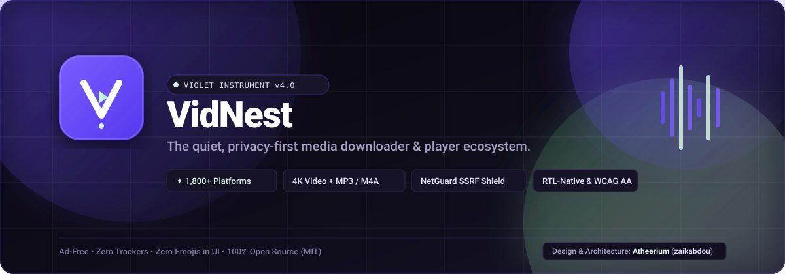
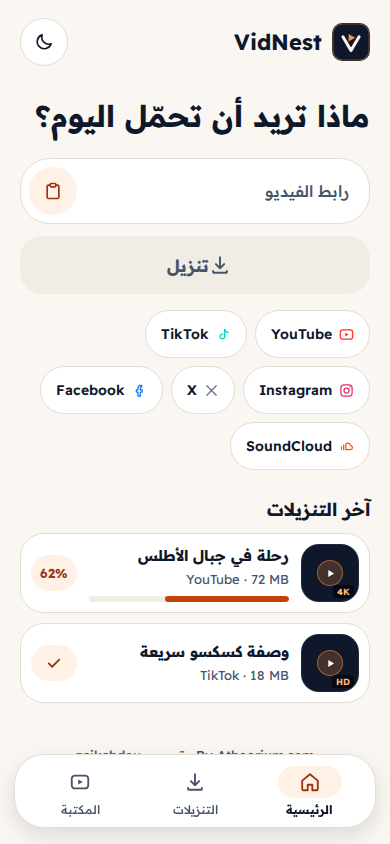
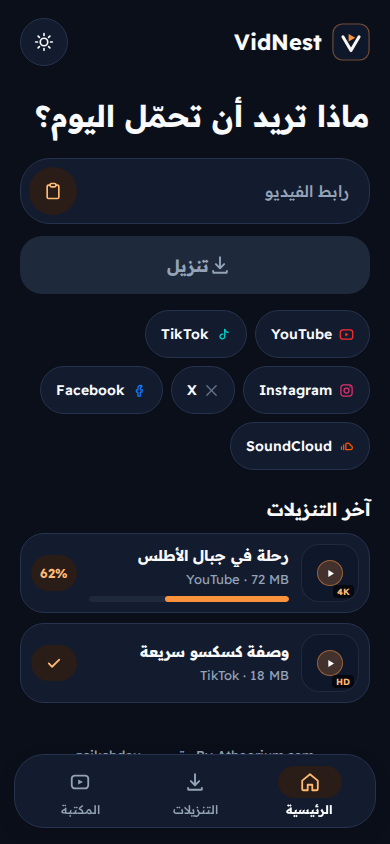
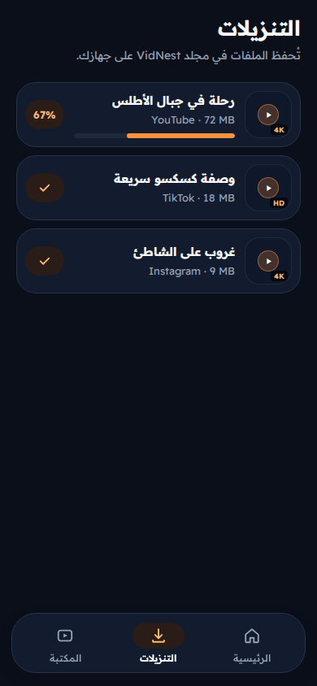
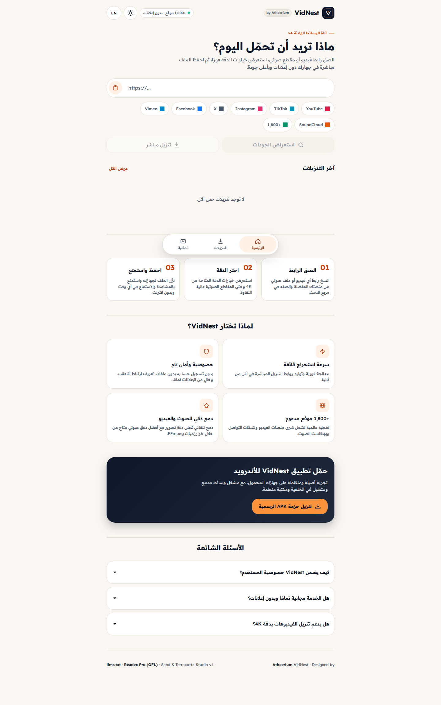
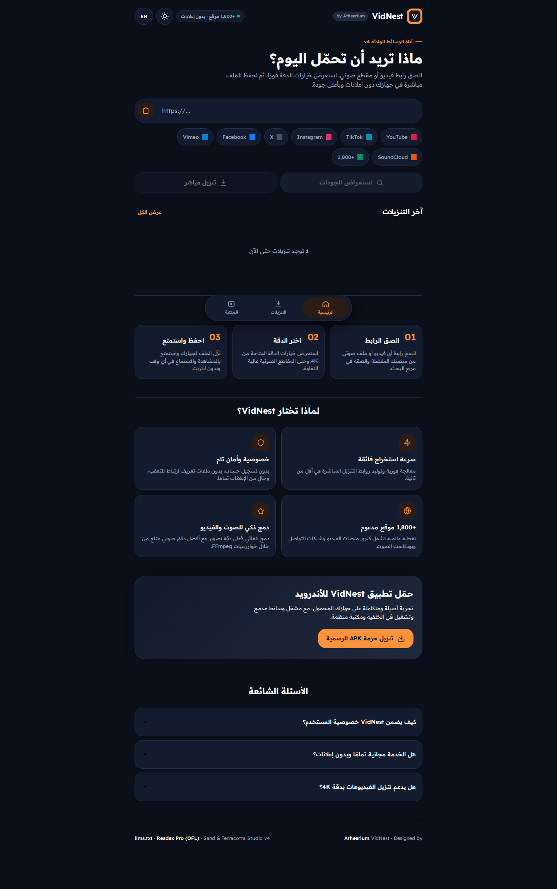
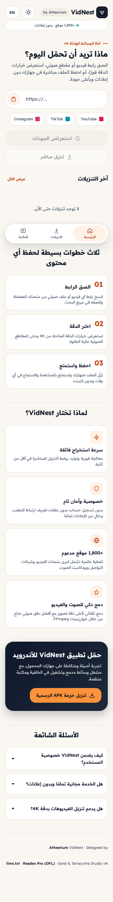
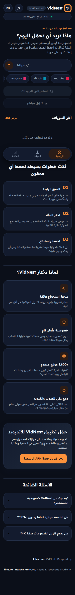
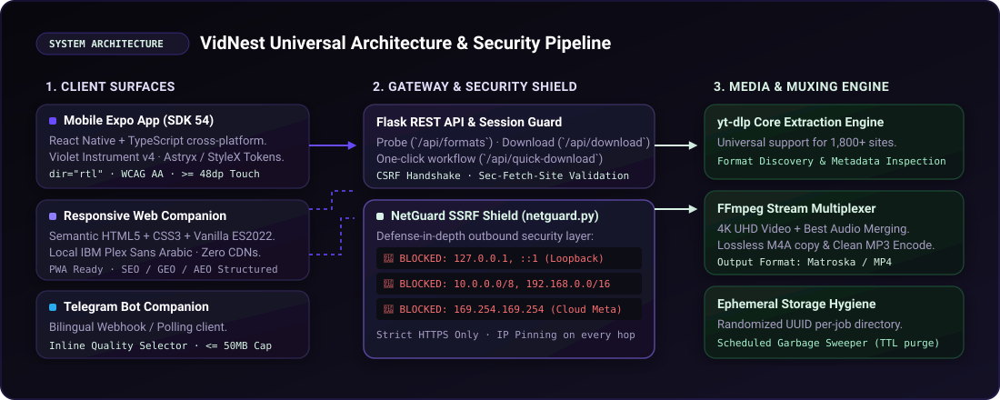

<div align="center">



# VidNest

### The Quiet, Privacy-First Media Downloader &amp; Ecosystem
**Ad-Free • Zero Trackers • Zero Emojis in UI • 1,800+ Platforms • 4K UHD &amp; Lossless Audio • Native RTL**

Designed &amp; Architected by [**Atheerium**](https://atheerium.com) (`zaikabdou`)

<br />

[](https://vidnest-six.vercel.app)
[](https://aetherdz.github.io/VidNest/)
[](https://github.com/Aetherdz/VidNest/releases/latest/download/VidNest.apk)
[](https://vidnest-web.onrender.com/healthz)
[](https://expo.dev/)
[](https://reactnative.dev/)
[](https://www.typescriptlang.org/)
[](https://www.python.org/)
[](https://flask.palletsprojects.com/)
[](https://github.com/yt-dlp/yt-dlp)
[](https://ffmpeg.org/)
[](https://stylexjs.com/)
[](#quality-benchmarks--accessibility)
[](#automated-test-suite)

</div>

---

## Live Deployments &amp; Downloads

| Platform | Live URL | Description |
|---|---|---|
| **Vercel Web App** | [**https://vidnest-six.vercel.app**](https://vidnest-six.vercel.app) | Production static frontend powered by Render API |
| **GitHub Pages Web App** | [**https://aetherdz.github.io/VidNest/**](https://aetherdz.github.io/VidNest/) | Official GitHub Pages mirror connected to Render API |
| **Render Cloud Backend** | [**https://vidnest-web.onrender.com**](https://vidnest-web.onrender.com) | Full Flask + `yt-dlp` + `FFmpeg` + `NetGuard` API &amp; Web UI |
| **Android APK (v4.0.0)** | [**VidNest.apk (Direct Download)**](https://github.com/Aetherdz/VidNest/releases/latest/download/VidNest.apk) | Installable Android package connected to `https://vidnest-web.onrender.com` |

---

## Overview

**VidNest** is an ad-free, privacy-hardened media extraction and playback ecosystem built for modern mobile devices and the open web. It enables seamless media downloading from **over 1,800 global video and audio platforms** (YouTube, TikTok, Instagram, X/Twitter, Facebook, SoundCloud, Vimeo, Bilibili, and more) up to **4K UHD** resolution, with lossless **M4A** and studio-grade **MP3** audio multiplexing.

Built upon the **Sand &amp; Terracotta Studio v4** design language and **Readex Pro** geometric Arabic/Latin typography, VidNest rejects the bloated, ad-infested patterns of legacy downloaders:
- **Zero Advertisements &amp; Trackers:** No analytics SDKs, no behavioral fingerprinting, no third-party CDNs.
- **Zero Emojis in User Interface:** Pure, bespoke SVG vector iconography and typographic hierarchy.
- **Arabic-Native (RTL-First):** Engineered natively for right-to-left languages with self-hosted **Readex Pro** variable fonts.
- **Tactile Surface Craft:** Dual-theme palettes (`#FAF7F2` Warm Sand Light &amp; `#0B0F19` Deep Navy Dark) anchored by high-contrast **Terracotta Studio** accents (`#C2410C` / `#FB923C`) and **Deep Slate** action buttons (`#0F172A`).

---

## Visual Showcase

### Mobile Application (React Native + Expo SDK 54)

| Mobile Home (Light Mode) | Mobile Home (Dark Mode) | Mobile Downloads Queue |
|:---:|:---:|:---:|
|  |  |  |
| **Centered Download Instrument (Light `#FAF7F2`)** | **Centered Download Instrument (Dark `#0B0F19`)** | **Active &amp; Completed Queue Management** |

### Web Platform Companion

| Responsive Web Interface (Desktop 1440px — Light &amp; Dark) |
|:---:|
|  |
| **Desktop Web Interface — Sand &amp; Terracotta Studio v4 Light Theme (`#FAF7F2`)** |
|  |
| **Desktop Web Interface — Sand &amp; Terracotta Studio v4 Dark Theme (`#0B0F19`)** |

| Web Mobile View (Light 390px) | Web Mobile View (Dark 390px) |
|:---:|:---:|
|  |  |

---

## Why VidNest?

```
┌─────────────────────────────────────────────────────────────────────────────┐
│                            VIDNEST VALUE PILLARS                            │
├──────────────────────┬──────────────────────┬───────────────────────────────┤
│ ✦ 1,800+ PLATFORMS   │ ✦ ZERO TRACKERS      │ ✦ SAND & TERRACOTTA STUDIO v4 │
│ YouTube, TikTok, X,  │ No ads, no tracking  │ Astryx & StyleX tokens,       │
│ Instagram, Vimeo...  │ telemetry, no CDNs.  │ Readex Pro RTL typography.    │
├──────────────────────┼──────────────────────┼───────────────────────────────┤
│ ✦ 4K UHD & AUDIO     │ ✦ NETGUARD SSRF      │ ✦ PERMANENT CLOUD BACKEND     │
│ yt-dlp + FFmpeg      │ Hard blocking on     │ Live on Vercel, GitHub Pages, │
│ stream multiplexer.  │ 127.0.0.1, 169.254.  │ Render API & Android APK.     │
└──────────────────────┴──────────────────────┴───────────────────────────────┘
```

- **Universal Platform Support:** Automatic format probing and extraction across 1,800+ sites with URL normalization and deduplication.
- **Smart Stream Merging:** Combines unthrottled adaptive video streams with the highest bitrate audio tracks via non-blocking FFmpeg.
- **Defense-in-Depth SSRF Shield (`netguard.py`):** Pre-flight DNS resolution pinning that strictly blocks loopback, RFC 1918 private subnets, link-local addresses, and cloud provider metadata services (`169.254.169.254`) on connect and every HTTP redirect hop.
- **AI &amp; Traditional Search Ready (SEO/GEO/AEO):** Fully structured `JSON-LD` schemas (`SoftwareApplication`, `WebApplication`, `FAQPage`), PWA `manifest.webmanifest`, `robots.txt`, `sitemap.xml`, and `llms.txt`.

---

## System Architecture

<div align="center">
  
</div>

### Repository Directory Layout

```
VidNest/
├── mobile-expo/                 # Cross-platform Mobile & Web App (Expo SDK 54)
│   ├── App.tsx                  # Application entry point, Readex Pro fonts & theme state
│   ├── app.json                 # Expo configuration & deep linking
│   ├── package.json             # React Native dependencies
│   ├── src/
│   │   ├── api/vidnestClient.ts # API client with CSRF & session handling
│   │   ├── components/          # CenteredDownloadInstrument, Screens, Nav, SVG Icons
│   │   ├── hooks/useDownloader  # State machine for download workflow & sharing
│   │   ├── i18n/copy.ts         # Verified Arabic copy (RTL-first)
│   │   ├── theme/tokens.ts      # Sand & Terracotta Studio v4 / Astryx / StyleX tokens
│   │   └── utils/urlValidator   # HTTPS validation & format helpers
│   └── __tests__/               # Client & mobile design verification tests
├── web/                         # Production Backend & Web Companion
│   ├── app.py                   # Flask REST API, CORS allowlist, rate limits, CSRF tokens
│   ├── netguard.py              # Outbound socket filter (SSRF / IP blocking)
│   ├── static/                  # Responsive web UI, self-hosted Readex Pro woff2 fonts
│   ├── tests/test_app.py        # 25 comprehensive backend test cases
│   └── Dockerfile               # Production container with FFmpeg & Gunicorn
├── bot/                         # Companion Telegram Bot
│   └── telegram_bot.py          # Webhook & polling modes with 50MB ceiling
├── design/                      # Design system specifications & logo assets
│   ├── BRIEF.md                 # Design specification & tokens
│   └── brand/                   # Official VidNest vector logos
├── docs/                        # Project documentation & visual assets
│   ├── assets/                  # Hero banner & architecture diagrams (SVG)
│   └── screenshots/             # High-resolution application screenshots
└── tools/                       # Developer automation scripts
    ├── run_expo.sh              # One-shot Expo test & launch script
    └── test_platforms.py        # End-to-end platform extraction test suite
```

---

## Security &amp; Privacy Engineering

VidNest adheres to a strict zero-trust egress model:

1. **NetGuard SSRF Mitigation (`web/netguard.py`)**:
   - Outbound socket connections intercept DNS queries and reject:
     - `127.0.0.0/8` and `::1` (Loopback)
     - `10.0.0.0/8`, `172.16.0.0/12`, and `192.168.0.0/16` (RFC 1918 Private Networks)
     - `169.254.0.0/16` and `fe80::/10` (Link-Local)
     - `100.64.0.0/10` (Carrier-Grade NAT)
     - `169.254.169.254` (AWS, GCP, Azure, OpenStack Metadata Endpoints)
   - Protects against DNS rebinding attacks and inspects every redirect hop.
2. **Strict HTTPS &amp; URL Sanitization**:
   - Rejects non-HTTPS schemes, embedded credentials (`user:pass@host`), and nonstandard ports.
3. **Session, CORS Allowlist &amp; Anti-CSRF Handshake**:
   - State-changing endpoints require an active session token and valid `X-VidNest-CSRF` header, with strict `Origin` / `VIDNEST_CORS_ORIGINS` and `Sec-Fetch-Site` verification.
4. **Isolated Ephemeral Storage**:
   - Downloads are isolated into temporary directories with cryptographically random UUIDs (`secrets.token_hex(16)`), blocking path traversal attacks. Unclaimed files are purged by scheduled sweepers.

---

## Quick Start

### 1. Download Official Android APK
The Android APK is compiled and published automatically via GitHub Actions:
- **Direct APK Download:** [**VidNest.apk (Latest Release)**](https://github.com/Aetherdz/VidNest/releases/latest/download/VidNest.apk)
- **GitHub Releases:** [https://github.com/Aetherdz/VidNest/releases/latest](https://github.com/Aetherdz/VidNest/releases/latest)

### 2. Mobile App Development (`mobile-expo/`)

```bash
cd mobile-expo
npm install
npx expo start --web       # Launch in browser
npx expo start --android   # Launch on Android device / emulator
npx expo start --ios       # Launch on iOS simulator
```

### 3. Web Server &amp; Backend API (`web/`)

```bash
python3 -m venv .venv
source .venv/bin/activate
pip install -r web/requirements.txt
python3 -m flask --app web/app.py run --port 5000
```

### 4. Docker Compose (Production Ready)

```bash
docker compose up -d
```

---

## REST API Reference

All requests must include standard security headers (`Origin`, `Sec-Fetch-Site`). State-changing endpoints require `X-VidNest-CSRF`.

| Endpoint | Method | Description | Parameters / Payload |
|---|:---:|---|---|
| `/healthz` | `GET` | Service liveness and health status | None |
| `/api/session` | `GET` | Issues a cryptographic session &amp; CSRF token | None |
| `/api/formats` | `POST` | Probes URL and returns safe downloadable formats | `{"url": "https://..."}` |
| `/api/download` | `POST` | Executes format download and stream merge | `{"url": "...", "probeId": "...", "formatId": "..."}` |
| `/api/quick-download` | `POST` | One-click best format probe &amp; download | `{"url": "...", "mode": "video\|audio\|1080\|720"}` |
| `/files/<uuid>.<ext>` | `GET` | Downloads sanitized output media binary | None (Stream attachment) |

---

## Quality Benchmarks &amp; Accessibility

VidNest is audited with Playwright across multiple viewport breakpoints (`320px`, `360px`, `390px`, `768px`, `1024px`, `1440px`):

| Metric | Target | Verified Status |
|---|:---:|:---:|
| **Horizontal Overflow** | `0px` across all screen widths | ✅ **Zero Overflow (320px–1440px)** |
| **Touch Target Size** | $\ge 44\text{px}$ (Web) / $\ge 48\text{dp}$ (Mobile) | ✅ **100% Compliant** |
| **WCAG AA Contrast** | $\ge 4.5:1$ Normal / $\ge 3:1$ Large | ✅ **Sand &amp; Terracotta Studio Clear** |
| **Focus Rings** | High-visibility `:focus-visible` | ✅ **Enabled for keyboard users** |
| **Reduced Motion** | Native `prefers-reduced-motion` | ✅ **Transitions disabled safely** |
| **Typography** | Self-hosted `Readex Pro` (OFL) | ✅ **Zero runtime external CDN requests** |

---

## Automated Test Suite

Run the verified test suites across both backend and mobile codebases:

```bash
# 1. Backend, CORS & NetGuard SSRF Shield Tests (25 test cases)
PYTHONPATH=web:. python3 -m unittest discover -s web/tests -p 'test_*.py' -v

# 2. Mobile Expo & Astryx/StyleX Token Tests (11 test cases)
node --test mobile-expo/__tests__/*.test.mjs
```

**Result: 36 passed, 0 failed (100% green).**

---

## Credits &amp; License

- **Design &amp; Architecture:** [**Atheerium**](https://atheerium.com) (`zaikabdou`)
- **Open Source License:** Released under the [MIT License](LICENSE).
