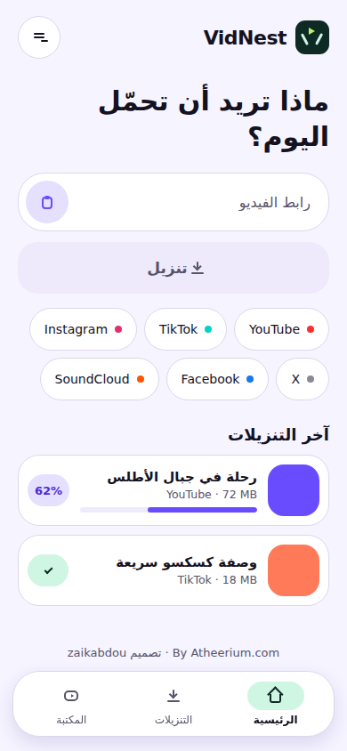
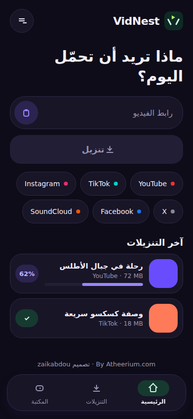
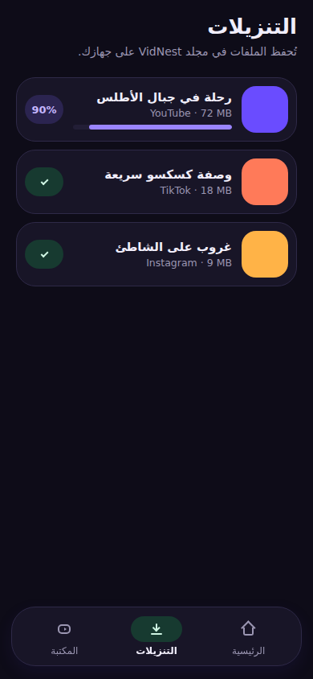
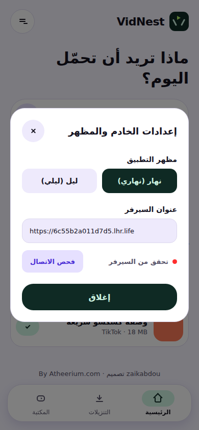

<div align="center">

# VidNest Mobile &amp; Web Application

### Cross-Platform Client powered by React Native + Expo SDK 54
**Violet Instrument v4 • Astryx Design &amp; StyleX Tokens • Native RTL Arabic • WCAG AA**

Designed &amp; Architected by [**Atheerium**](https://atheerium.com) (`zaikabdou`)

<br />

[](https://expo.dev/)
[](https://reactnative.dev/)
[](https://www.typescriptlang.org/)
[](https://stylexjs.com/)
[](#tests)

</div>

---

## Overview

The **VidNest Expo Application** is a high-performance cross-platform client targeting Android, iOS, and modern web browsers. It provides an intuitive, distraction-free interface for extracting video and audio from 1,800+ supported media hosts with instant format selection, background caching, and native share-sheet triggering.

---

## Visual Showcase

| Light Theme (`#F7F5FF`) | Dark Theme (`#0B0A10`) |
|:---:|:---:|
|  |  |
| **Centered Download Instrument (Light)** | **Centered Download Instrument (Dark)** |

| Downloads Management | Settings &amp; Configuration |
|:---:|:---:|
|  |  |
| **Active Transfers &amp; Offline Cache** | **Theme Switcher &amp; API Endpoint** |

---

## Architecture & Code Organization

- **`App.tsx`**: Main entry point; controls theme toggling (Light / Dark), active screen routing, and API base URL configuration (`EXPO_PUBLIC_VIDNEST_API_URL`, defaulting to `https://vidnest.fly.dev` or a custom endpoint).
- **`src/components/CenteredDownloadInstrument.tsx`**: The signature centered download instrument UI (**زر التحميل بالنص**), featuring URL extraction from clipboard, mode pills (**فيديو MP4**, **صوت فقط**, **اختيار الدقة**), and real-time platform chip highlighting.
- **`src/components/`**: Modular screens including `HomeScreen.tsx`, `DownloadsScreen.tsx`, `LibraryScreen.tsx`, `SettingsModal.tsx`, `BottomNav.tsx`, and bespoke vector SVG `Icons.tsx`.
- **`src/hooks/useDownloader.ts`**: Complete state management hook for probing formats, executing downloads, maintaining local history, and triggering native share sheets.
- **`src/api/vidnestClient.ts`**: Secure HTTP client with automatic session initialization, CSRF token handshaking, and error diagnostics.
- **`src/utils/urlValidator.ts`**: Precision URL extraction, HTTPS enforcement, SSRF mitigation, and safe duration/byte formatters.
- **`src/theme/tokens.ts`**: Color, radius, typography, and motion tokens aligned with `@astryxdesign/core`, `@astryxdesign/theme-neutral`, and `@stylexjs/stylex`.
- **`src/i18n/copy.ts`**: Verified Arabic localization strings built for natural RTL text flow.

---

## Design System: Violet Instrument v4

- **RTL-First Layout:** Natural right-to-left layout for Arabic text and interactive controls.
- **Dual Themes:** Light theme (`#F7F5FF`) and Dark theme (`#0B0A10`).
- **Primary CTA:** Forest Studio green (`#143326` in light / `#D8F3E5` in dark).
- **Accessibility:** Touch targets $\ge 48\text{dp}$, WCAG AA contrast ratio $\ge 4.5:1$, visible focus states, reduced-motion compliance, and zero emojis in the interface.

---

## Getting Started

### Installation

```bash
npm install
```

### Development Launch

```bash
# Start web client
npx expo start --web

# Start Android client (requires Android Studio emulator or physical device)
npx expo start --android

# Start iOS client (macOS only)
npx expo start --ios
```

### Automated Tests

```bash
node --test __tests__/*.test.mjs
```

---

## Credits & License

- **Design & Architecture:** [**Atheerium**](https://atheerium.com) (`zaikabdou`)
- **License:** Open source under the [MIT License](../LICENSE).
